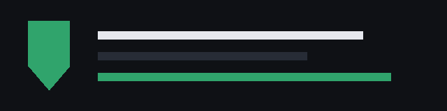
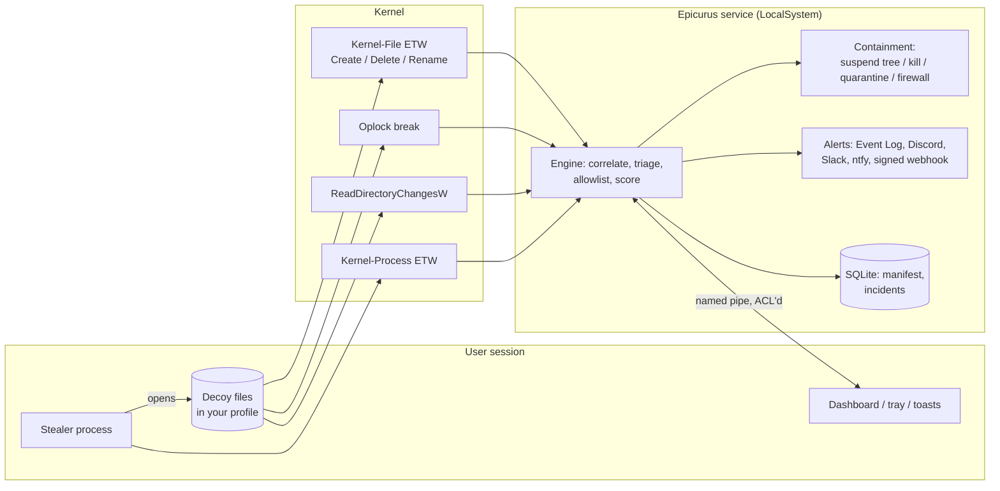

# Epicurus

**An open-source Windows tripwire that catches infostealers in the act: decoy developer credentials, kernel-level attribution, instant containment.**

[](https://github.com/ide-bloom/epicurus/actions/workflows/ci.yml)
[](https://github.com/ide-bloom/epicurus/releases)
[](#license)



> The GIF above is a placeholder until the first release demo is recorded. See [docs/media/README.md](docs/media/README.md) for how it is produced.

Epicurus plants realistic decoy credentials where infostealers look: AI coding-agent tokens, MCP server configs, cloud keys, browser stores, wallets, messaging sessions. Legitimate software has no reason to open them. When something does, Epicurus identifies the process with kernel ETW, suspends its whole process tree, alerts you, and writes a forensic report.

Epicurus is part of the **Palisade** toolkit for developer security in the AI-agent era, with its sister projects [Hush](https://github.com/ide-bloom/hush) and [Chaperone](https://github.com/ide-bloom/chaperone).

## Contents

- [Why Epicurus exists](#why-epicurus-exists)
- [How it works](#how-it-works)
- [Install](#install)
- [Quick start](#quick-start)
- [CLI reference](#cli-reference)
- [Decoy catalog](#decoy-catalog)
- [Configuration](#configuration)
- [Threat model and limitations](#threat-model-and-limitations)
- [FAQ](#faq)
- [Roadmap](#roadmap)
- [Sister projects](#sister-projects)
- [Contributing, security, license](#contributing)

## Why Epicurus exists

Infostealers no longer stop at browser passwords. Through 2026, public research documented stealer families harvesting the secrets developers keep on disk for their AI tools:

- **Gen Digital** found stealer collection rules naming the local data of Claude, Cursor, Codex, Cline, Continue and OpenCode (tokens, MCP configurations, prompt histories), with families such as Remus and Amatera adding AI-agent paths. See [*Infostealers are coming for your AI agent*](https://www.gendigital.com/blog/insights/research/infostealers-your-ai-agent) and the [H1 2026 threat report](https://www.gendigital.com/blog/insights/reports/threat-report-h1-2026).
- **SpyCloud** reported 18.1 million exposed API keys and tokens and 6.2 million AI-tool credentials or cookies recaptured from 2025 data ([2026 Identity Exposure Report](https://spycloud.com/blog/2026-annual-identity-exposure-report/)), and later documented WardenStealer and Aoki collecting tokens and config files for Claude Code, Codex, Cursor and GitHub Copilot ([*Infostealers now target AI tokens and API keys*](https://spycloud.com/blog/infostealers-now-target-ai-tokens-and-api-keys/)).
- **Hudson Rock** analysed Warden's payload folders targeting Claude Code, Codex CLI, GitHub and SSH keys ([*Infostealers are actively hunting AI agents and developer keys*](https://www.hudsonrock.com/blog/infostealers-are-actively-hunting-ai-agents-and-developer-keys-warden-infostealer)) and a surge of infections aimed at OpenClaw agent configs ([*2026 infostealer trends*](https://www.hudsonrock.com/blog/2026-infostealer-trends-im-monitoring-at-hudson-rock)).

Antivirus catches known samples. A tripwire catches behavior: no matter how new the stealer is, it has to open the files it came for. Decoys make that moment observable, and a decoy hit is a high-signal event with very few false positives.

Epicurus is strictly defensive. It never transmits anything except to alert channels you configure, and it never reads, copies or modifies your real credentials.

## How it works



1. **Decoys.** `install` plants up to 47 decoys from a data-driven catalog (browser and wallet decoys depend on what is installed): realistic file names, formats, backdated timestamps and sizes, with secrets that match each provider's public format but are random and invalid. Layout choices come from a per-install seed, so no two machines look alike. Nothing is ever overwritten, and nothing is planted in OneDrive, Dropbox or Google Drive folders or inside git working trees.
2. **Sensors.** A real-time ETW session on `Microsoft-Windows-Kernel-File` reports every open of a decoy with the opening PID. Independently, an oplock held on each decoy breaks the instant another process opens it, which gives a precise timestamp and forces an immediate ETW flush. A directory watcher catches deletion, rename and modification. `Microsoft-Windows-Kernel-Process` keeps a PID+start-time process table, so even a stealer that exits right after its sweep is attributed. If kernel ETW is unavailable, Epicurus falls back to SACL auditing and Security event 4663.
3. **Triage.** For the touching process: image hash, Authenticode signer chain (embedded or catalog), parent chain, command line, user and integrity level, image location and age, other real credential stores it opened, network connections and loaded modules.
4. **Scoring.** A 0–100 score with an explanation for every point. Touching decoys in three categories within the sweep window (10 s by default) is treated as a near-certain stealer and scores critical.
5. **Containment.** By default, high and critical incidents suspend the entire process tree and wait for your decision: kill tree, resume, quarantine the image, block its network access, or allowlist it. Critical system and protected (PPL) processes are never touched.
6. **Reporting.** Toasts with Kill / Resume / Open buttons, Event Log entries for SIEMs, optional webhooks, and per-incident JSON, self-contained HTML and STIX 2.1 exports.

Details: [docs/architecture.md](docs/architecture.md).

## Install

Requirements: Windows 11 (24H2 or later) or Windows Server 2025, x64 or ARM64, administrator rights for installation.

1. Download `epicurus-<version>-windows-<arch>.zip` from [Releases](https://github.com/ide-bloom/epicurus/releases) and verify it against `SHA256SUMS`. Releases carry GitHub build provenance attestations: `gh attestation verify epicurus-*.zip --repo ide-bloom/epicurus`.
2. Extract it and run, from a normal (non-elevated) terminal:

   ```powershell
   .\epicurus.exe install
   ```

   Epicurus asks for UAC elevation. It records *your* account as the protected user before elevating, so over-the-shoulder elevation with a different admin account still protects the right profile.

What `install` does:

- copies `epicurus.exe` to `%ProgramFiles%\Epicurus` (a service binary must live where only administrators can write);
- creates `%ProgramData%\Epicurus` with an ACL granting only SYSTEM and Administrators;
- registers the `Epicurus` Event Log source and an all-users Start Menu shortcut carrying the toast AppUserModelID;
- registers and starts the `Epicurus` service (LocalSystem, automatic start, restart on failure);
- plants the default decoy set and prints exactly what went where.

The service starts the tray agent in your session at logon.

Build from source: `cargo build --release -p epicurus-cli` (Rust stable, MSVC toolchain). The C runtime is linked statically, so `epicurus.exe` has no redistributable dependency.

## Quick start

```powershell
epicurus status      # protection state and sensor health
epicurus simulate    # harmless stealer sweep: expect a critical, suspended, correctly attributed incident
epicurus ui          # dashboard
epicurus doctor      # if anything looks off
```

`simulate` launches a child process (the same executable with a hidden flag). The child asks the service for Epicurus's own manifest, reads up to six decoys across categories at once from parallel workers (as many stealers collect), then lingers like a stealer packaging its loot. It never touches real files and transmits nothing. The incident is tagged as a simulation, and the child is killed afterwards unless you pass `--keep`.

## CLI reference

| Command | Behavior |
|---|---|
| `install [--profile <name>] [--no-plant]` | Elevate through UAC if needed, install binary, data directory, Event Log source, shortcut and service, plant decoys, start protecting. |
| `uninstall [--keep-data]` | Remove every decoy whose hash still matches the manifest, the service, firewall rules Epicurus added, the shortcut and toast registration, the Event Log source, the install directory and (unless `--keep-data`) `%ProgramData%\Epicurus`. Restores the audit policy if the fallback sensor changed it. |
| `plant [--profile <name>] [--dry-run]` | Plant decoys. `--dry-run` prints the full plan (targets, sizes, skipped decoys and why) and changes nothing. |
| `unplant` | Remove all decoys whose content is unchanged; modified decoys are left in place and listed. |
| `status [--json]` | Protection state, sensor health, decoy counts, incidents awaiting a decision, recent incidents. |
| `ui` | Open the dashboard. (`ui --tray` runs the notification-area agent; the service starts it for you.) |
| `incidents [--json] [--limit N]` | List incidents. |
| `export <incident-id> [--out DIR]` | Write `incident-<id>.json`, `incident-<id>.html` and `incident-<id>.stix.json`. |
| `simulate [--linger-secs N] [--keep]` | Run the built-in harmless stealer simulation and report detection, attribution and containment. |
| `doctor [--json]` | Diagnose Windows version, elevation, service, Event Log source, IPC, active sensor mode, ETW session and lost events, oplock support per volume, decoy health, synced folders, audit policy, other security software and Controlled Folder Access. |

Exit codes: `0` success, `1` error, `2` partial success (some decoys failed or were kept), `3` service not running (`status`).

## Decoy catalog

The catalog is data ([decoys/catalog.toml](decoys/catalog.toml)), embedded at build time:

| Category | Decoys |
|---|---|
| AI coding agents | Claude Code credentials and `~/.claude.json`, OpenAI Codex `auth.json`, Cursor and Windsurf `state.vscdb`, Gemini CLI `oauth_creds.json`, GitHub Copilot `apps.json`, OpenClaw-style `openclaw.json` and agent `auth-profiles.json` |
| MCP configs | Claude Desktop, project `.mcp.json`, Cursor, Windsurf, Codex `config.toml`, Gemini `settings.json`, with GitHub, Slack, Notion, Postgres and Stripe servers carrying keys |
| Cloud and developer | `~/.aws/credentials`, Azure CLI profile and MSAL cache, gcloud ADC, GCP service-account key, `~/.kube/config`, `~/.docker/config.json`, `.npmrc`, `.pypirc`, `.git-credentials`, an SSH key pair in `~/.ssh/<old>/`, a project `.env` |
| Browser stores | A fresh decoy profile (`Profile N`) with `Login Data`, `Network\Cookies` and `Preferences` for Chrome, Edge and Brave, only if that browser is installed; `Local State` and real profiles are never touched |
| Crypto wallets | Exodus, Electrum, Atomic, and a MetaMask-shaped LevelDB inside the Chrome decoy profile, each only when the real wallet is absent |
| Messaging | Telegram `tdata`-shaped files and a Discord Local Storage LevelDB, in decoy locations only |
| Password exports | A forgotten `passwords-export-2024.csv` |

If a real tool is installed, its real files are never touched; the decoy goes to a plausible alternate (`.bak`, a legacy directory name). Profiles: `default` (everything), `ai`, `developer`, `minimal`. You can add or replace decoys with TOML files in `%ProgramData%\Epicurus\catalog.d\`. See [docs/decoy-catalog.md](docs/decoy-catalog.md) for the schema and every generator.

**Live canaries.** Put credentials you generated yourself (for example an AWS key from canarytokens.org) in the config, and Epicurus plants those instead of random values, so the canary provider alerts if the stolen key is ever used. Epicurus itself never phones home.

## Configuration

`%ProgramData%\Epicurus\config.toml` (most of it is editable from the dashboard):

```toml
[protection]
profile = "default"            # catalog profile
disabled_categories = []       # e.g. ["wallet"]
auto_replant = true            # re-plant after a decoy is deleted or modified

[sensor]
mode = "auto"                  # "auto" (ETW, SACL fallback) or "audit"
oplock = true
correlation_window_ms = 3000   # how long an oplock break waits for attribution
sweep_window_secs = 10

[policy]                       # observe | alert | suspend
info = "observe"
low = "alert"
medium = "alert"
high = "suspend"
critical = "suspend"
minidump = false               # dumps are large and contain whatever the process already read

[alerts]
min_severity = "low"
toast = true
eventlog = true
dedupe_window_secs = 600
max_per_minute = 10
# Webhook URLs, ntfy topics/tokens and HMAC keys are set from the dashboard
# and stored DPAPI-encrypted by the service (only LocalSystem can decrypt).

[canaries]
aws_access_key_id = "AKIA...your canary..."
aws_secret_access_key = "..."
```

Alert channels: Windows toast (Kill / Resume / Open), Windows Event Log (event IDs in [docs/event-ids.md](docs/event-ids.md)), Discord, Slack, ntfy, and a generic JSON webhook signed with `X-Epicurus-Signature: sha256=HMAC(secret, "<timestamp>.<body>")`. Every channel has a "send test" button. Alerts are deduplicated per image and severity and rate-limited per channel.

The **allowlist** (`allowlist.toml`, editable in the dashboard) matches a valid Authenticode signer *plus* an image path pattern, optionally pinned to a SHA-256, or a SHA-256 alone. It never matches on a process name alone. Built-in entries cover Microsoft Defender, the Windows Search indexer and common backup agents (Veeam, Acronis, Backblaze, Macrium, CrashPlan, Carbonite). Allowlisted touches are logged at info level and never alerted.

## Threat model and limitations

Epicurus raises the cost of credential theft and turns it into a loud, attributable event. It is not a complete EDR. Read [docs/threat-model.md](docs/threat-model.md) before relying on it. In short:

- **Kernel-level malware** (rootkits, malicious drivers) can hide file access from ETW and the file system. Out of scope.
- **Admin-level malware** can stop the ETW session, stop the service or clear logs. Epicurus detects its own session stopping and the oplock tripwire still fires without ETW. A burst of unattributed tripwire hits raises an incident on its own, but an attacker with admin rights ultimately wins.
- **Decoy-aware stealers** could fingerprint decoys. Per-install randomization, realistic formats, user ownership and backdating raise that bar; they do not make it impossible.
- **Race window.** Detection happens when the file is opened, so the stealer may already hold decoy bytes (worthless) and real secrets it read *before* touching a decoy. Containment stops further collection and exfiltration from the suspended tree; it cannot un-read files. Rotate secrets after any real incident; the report lists what to rotate.
- **Coverage depends on stealers touching decoys.** A stealer that only targets one exact real file Epicurus has no decoy for will not trip it.

## FAQ

**Will decoys break my tools?** No. Epicurus never writes into files or locations a real tool uses. If the tool is installed, its decoy goes to an alternate path the tool never reads. `plant --dry-run` shows every target first.

**Do decoys sync to the cloud or end up in git?** No. Targets inside OneDrive, Dropbox, Google Drive (and iCloud/Box) roots or inside any git working tree are rejected.

**Are the fake tokens dangerous if leaked?** They are random. Where a format carries a checksum (GitHub, npm tokens) the checksum is deliberately wrong, so the provider rejects them offline. Literal token-shaped strings never appear in this repository; prefixes are assembled at runtime.

**What does it cost in performance?** Only Create, DeletePath and RenamePath file events are consumed (not reads or writes), and they are filtered against a hash set. Oplocks are passive.

**Why suspend instead of kill?** A suspended process can be inspected and you decide. The default keeps false positives from destroying work.

**My backup tool tripped it.** Allowlist it from the incident ("Allowlist" uses its signer and path) or add an entry in the dashboard.

## Roadmap

- Signed releases (Authenticode) and a winget package
- Per-user protection for multi-user machines
- ETW-based read volume telemetry (opt-in) for richer scoring
- More catalog entries as stealer families evolve (contributions welcome)
- Integration with Hush and Chaperone for coordinated secret rotation

## Security

Report vulnerabilities privately as described in [SECURITY.md](SECURITY.md). Do not open public issues for security bugs.

## License

Dual-licensed under [MIT](LICENSE-MIT) or [Apache-2.0](LICENSE-APACHE), at your option.
